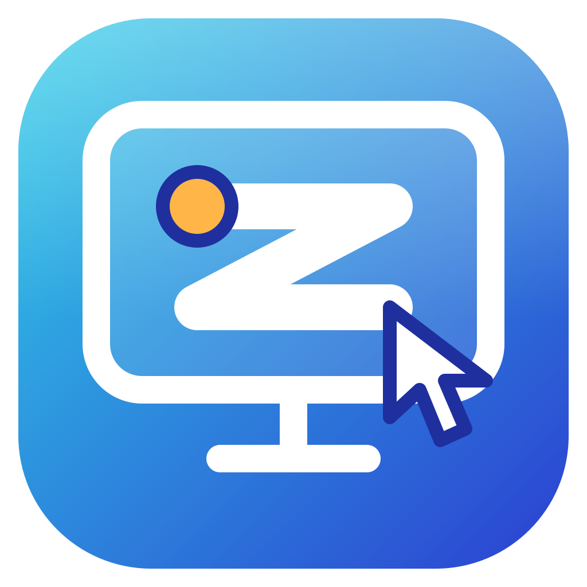

  

<h1 align="center">ZIVAR Remote Desk</h1>

  Kontrol komputer Anda dari mana saja, cukup dengan ID dan kata sandi. 
  Remote desktop gratis untuk Windows dan Android.

  
  

  <a href="README.md">English</a> · <b>Bahasa Indonesia</b>

  <a href="https://github.com/ravizulfikar/zivar-remote-desk-release/releases/latest">Unduh</a> ·
  <a href="CHANGELOG.id.md">Catatan perubahan</a> ·
  <a href="LICENSE">Lisensi MIT</a>

---

## Apa itu ZIVAR Remote Desk?

Aplikasi untuk melihat dan mengontrol komputer lain dari jarak jauh, seolah-olah Anda duduk di depannya. Cocok untuk mengakses komputer kantor atau komputer di rumah dari laptop, komputer lain, atau ponsel Android.

Tidak ada akun yang perlu dibuat. Setiap komputer punya **ID 9 digit** dan **kata sandi** yang Anda tentukan sendiri. Siapa yang tahu keduanya, dialah yang bisa tersambung.

## Fitur

**Menyambung**
- **ID tetap**: ID komputer tidak berubah, bahkan setelah aplikasi dipasang ulang.
- **Kata sandi Anda tidak pernah dikirim** ke siapa pun saat menyambung.
- **Riwayat koneksi**: komputer yang pernah Anda hubungi tersimpan lengkap dengan nama dan favorit. Satu ketukan untuk tersambung lagi, dan kata sandinya dapat diingat dengan aman di Windows.
- **Jaringan lokal**: di kantor atau rumah, sambungkan memakai alamat IP komputer, bahkan tanpa internet.
- **Jaringan kantor dengan proxy**: pengaturan proxy tersedia di dalam aplikasi.

**Saat mengontrol**
- **Gambar mulus**: kualitas menyesuaikan diri dengan kecepatan koneksi Anda secara otomatis. Anda juga bisa memilih Tinggi, Sedang, atau Rendah.
- **Terminal saja**: buka hanya baris perintah (PowerShell) di komputer tujuan, tanpa melihat layarnya. Fitur ini mati secara default dan harus dinyalakan pemilik komputer.
- **Komputer terkunci**: lihat dan kontrol komputer yang sedang terkunci, termasuk mengetik kata sandi Windows dan menyetujui jendela izin administrator (UAC). Perlu satu kali persetujuan administrator untuk memasang komponen tambahannya.

**Di komputer yang dikontrol**
- **Tanda yang jelas**: selama dikontrol tampil bingkai merah di tepi layar dan tombol **Putuskan** yang selalu di atas.
- **Tanya dulu**: opsi meminta persetujuan setiap ada yang ingin tersambung.
- **Beranda dengan riwayat akses**: lihat siapa saja yang pernah tersambung, kapan, dan berapa lama.
- **Berjalan diam-diam di latar belakang**: menutup jendela hanya menyembunyikannya ke ikon di area notifikasi, sehingga komputer tetap bisa dihubungi. Bisa juga otomatis berjalan saat Windows dimulai.

**Di Android**
- **Kontrol sentuh**: geser untuk menggerakkan kursor, ketuk untuk klik, ketuk dua jari untuk klik kanan, geser dua jari untuk scroll, tahan lalu geser untuk menyeret.
- **Perbesar tampilan**: cubit untuk memperbesar gambar di ponsel Anda (tidak mengubah layar komputer tujuan), serta keyboard layar dan tombol kontrol mengambang.

**Lainnya**
- Pemberitahuan versi baru lewat menu **Tentang**.
- Tema terang dan gelap mengikuti pengaturan perangkat.

## Unduh dan pasang

Ambil versi terbaru di halaman [Releases](https://github.com/ravizulfikar/zivar-remote-desk-release/releases/latest):

- **Windows**: `ZivarRemoteDesk_<versi>_x64-setup.exe`. Installer belum ditandatangani resmi, jadi Windows SmartScreen dapat memberi peringatan saat pertama dijalankan: pilih **Informasi lebih lanjut**, lalu **Tetap jalankan**.
- **Android**: `ZivarRemoteDesk_<versi>_android.apk`. Izinkan pemasangan dari sumber tidak dikenal. Ini versi uji coba (bukan dari Play Store).

Komputer yang dikontrol harus Windows. Android hanya untuk mengontrol komputer lain.

## Mulai memakai

**1. Siapkan komputer yang ingin dikontrol (Windows)**
1. Pasang dan buka aplikasi.
2. Buka **Pengaturan**, ketik kata sandi (minimal 8 karakter), lalu simpan.
3. Nyalakan **Izinkan akses jarak jauh**.
4. Catat **ID** yang tampil di **Beranda**.

**2. Sambungkan dari perangkat lain**
1. Pasang dan buka aplikasi (Windows atau Android).
2. Buka **Hubungkan**, ketik ID dan kata sandi komputer tujuan.
3. Pilih **Tampilan layar** atau **Terminal saja**, lalu tekan **Hubungkan**.

Komputer tujuan harus menyala dan terhubung ke internet (atau satu jaringan dengan Anda untuk sambungan lokal).

## Tips

- **Sambungan lokal**: nyalakan di **Pengaturan**, bagian **Jaringan lokal**. Aplikasi menampilkan alamat IP komputer. Windows mungkin meminta izin firewall; izinkan pada jaringan privat.
- **Komputer terkunci**: pasang komponen tambahannya di **Pengaturan**, bagian **Layar kunci** (butuh persetujuan administrator satu kali). Setelah memperbarui aplikasi, tekan **Perbarui layanan** di tempat yang sama.
- **Komputer kantor dengan proxy**: isi alamat dan port di **Pengaturan**, bagian **Proxy**.
- **Tetap aktif**: biarkan **Tetap berjalan di area notifikasi** menyala agar komputer tetap bisa dihubungi setelah jendelanya ditutup. Untuk keluar sepenuhnya, klik kanan ikonnya lalu pilih **Keluar**.

## Pakai dengan aman

- Gunakan kata sandi yang panjang dan unik, dan jangan bagikan ke orang yang tidak dipercaya.
- Nyalakan **Minta persetujuan manual** bila komputer sering dipakai orang lain.
- Nyalakan **Izinkan akses terminal** hanya jika memang dibutuhkan.
- Periksa **Riwayat akses** di Beranda sesekali.
- Bingkai merah di tepi layar berarti komputer sedang dikontrol. Tombol **Putuskan** mengakhiri sesi kapan saja.

## Lisensi

Dirilis di bawah [Lisensi MIT](LICENSE). Aplikasi ini memakai beberapa komponen pihak ketiga; daftarnya ada di [THIRD_PARTY_NOTICES.md](THIRD_PARTY_NOTICES.md).
