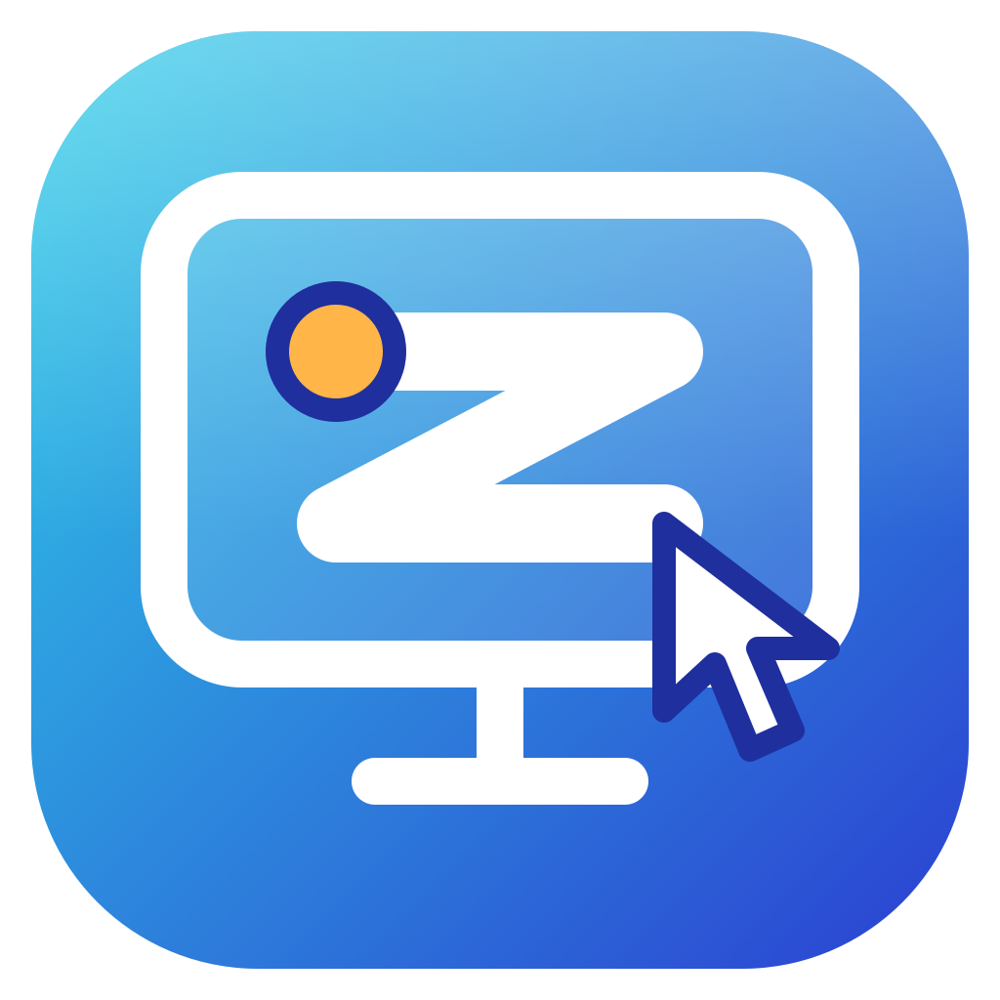

<p align="center">
  
</p>

<h1 align="center">ZIVAR Remote Desk</h1>

<p align="center">
  Remote desktop with a 9-digit ID and a password. Video, mouse and keyboard travel peer to peer over WebRTC;<br>
  a free Cloudflare Worker only introduces the two computers. Host for Windows, viewer for Windows and Android.
</p>

<p align="center">
  <a href="https://github.com/ravizulfikar/zivar-remote-desk-release/releases/latest"></a>
  <a href="LICENSE"></a>
</p>

<p align="center">
  <b>English</b> · <a href="README.id.md">Bahasa Indonesia</a>
</p>

<p align="center">
  <a href="https://github.com/ravizulfikar/zivar-remote-desk-release/releases/latest">Download</a> ·
  <a href="CHANGELOG.md">Changelog</a> ·
  <a href="docs/ROADMAP.md">Roadmap</a> ·
  <a href="LICENSE">MIT License</a>
</p>

---

```
signaling/   Cloudflare Worker + Durable Object: 9-digit IDs, relays SDP/ICE, limits password attempts, TURN credentials
client/      Tauri (Rust + WebView2): Host mode (being controlled) and Viewer mode (controlling)
```

## Features

**Connecting**
- Connect with a **9-digit ID and a password**. The password is never sent: the host sends a nonce and the viewer answers with an HMAC-SHA256 over a PBKDF2 key (200,000 iterations).
- **Permanent ID** (Windows): derived from the computer's identity (MachineGuid), so it stays the same after reinstalling the app. If it ever clashes with another computer it shifts once and stays permanent afterwards.
- **Connection history**: every computer you connected to is kept with a name, favourite flag and last-used time. Tick *Remember password* and the next connection is one tap. Passwords are encrypted with Windows DPAPI.
- **TURN relay** as a fallback when a direct connection is blocked (Cloudflare Realtime TURN).
- **Local network (LAN)**: connect by IP address, without the internet. See [Local network](#local-network-lan).
- **Locked computer and UAC** (optional Windows service): the lock screen and UAC prompts stay visible and controllable, including typing the Windows password. See [Locked computer](#locked-computer-and-uac).
- **Terminal only**: open just a shell (PowerShell) on the other computer, no screen. See [Remote terminal](#remote-terminal).
- **HTTP proxy** for networks that only reach the internet through a proxy (for example `10.15.3.20` port `80`). See [Using a proxy](#using-a-proxy).

**During a session**
- **Adaptive quality**: the host measures RTT, packet loss and bandwidth every 2 seconds and steps the picture down (8 Mbps 1080p30 down to 0.5 Mbps ~360p15) when the network is slow, and back up when it recovers. The viewer can pin High, Medium or Low and sees resolution, fps, bitrate and ping.
- **"Being controlled" marker** (Windows): a red frame around the screen and an always-on-top badge with a **Disconnect** button. Both are excluded from the capture, so the viewer does not see them.
- **Manual approval** (optional): ask before every connection.
- **Video codec and hardware acceleration**: Auto prefers H.264 and uses the graphics card's encoder when there is one. The codec and whether it runs on hardware or software are shown on the viewer. See [Video](#video-codec-and-hardware).
- **Android viewer**: touchpad-style control (drag to move, tap to click, two-finger tap to right-click, two-finger drag to scroll, hold and drag), an on-screen keyboard and a floating, movable control button. **Pinch to zoom** the picture on the phone (only on the phone, the other computer is not affected).

**On the host computer**
- **Runs in the background**: closing or minimizing the window hides it to the system tray and the ID stays online. Optionally starts with Windows, hidden in the tray. Only one copy can run. See [Running in the background](#running-in-the-background-windows).
- **Home and access history**: the **Home** tab shows this computer's ID and a list of everyone who connected to it: time, IP address, route (Internet or LAN), screen or terminal, the result (connected, wrong password, refused, terminal not allowed) and how long the session lasted. The list is stored only on this computer and can be cleared. All settings are in the **Settings** tab.
- **Check for updates and About**: shows the logo, name, version and https://zivar.my.id, and tells you when a newer version exists.
- A start-up splash, light and dark themes that follow the system, and a phone layout with a bottom tab bar.

## Download and install

The Windows installer and the Android APK are built by GitHub Actions for every `v*` tag of the private source repository and published in the public repository [zivar-remote-desk-release](https://github.com/ravizulfikar/zivar-remote-desk-release/releases) (no GitHub login needed to download).

- **Windows**: `ZivarRemoteDesk_<version>_x64-setup.exe`. The installer is not code-signed yet, so SmartScreen may warn on first run (More info, then Run anyway).
- **Android**: `ZivarRemoteDesk_<version>_android.apk`. Allow installing from unknown sources. This is a debug build for testing and it cannot be installed over a release build signed with a different key.

The server address and the access key are built into the app, so a fresh install connects at once: there is nothing to configure or type. The key is inside the downloadable file, so anyone who has the file can extract it and use your server and TURN allowance (not your computers, which stay protected by their ID and password). See [Self-hosting the server](#self-hosting-the-server-cloudflare-free).

### Using it

1. On the computer to be controlled: tab **Settings**, set a password (at least 8 characters) and switch on **Allow remote access**. The computer's ID is shown on **Home**.
2. On the other device: tab **Connect**, enter the ID and the password, tap **Connect**.

### Android controls

One finger drags the cursor, a tap is a left click, a two-finger tap is a right click, two fingers scroll, and hold-then-drag drags. The round floating button (movable) opens connection info, **Quality** (Auto / High / Medium / Low), **Keyboard** and **Disconnect**. Android is a viewer only; it cannot be controlled.

## Local network (LAN)

In **Settings**, the **Local network (LAN)** card: switch on *Allow direct connections from the local network*. The card then lists this computer's IP addresses. From another computer on the same network, type the address (for example `192.168.1.20`) instead of an ID in **Connect**.

- No internet is needed. The password check, encryption and video are the same as over the internet.
- A small relay inside the app listens on port **21118**. Windows may show a firewall prompt the first time; allow it on private networks.
- The viewer learns the computer's ID from the connection and saves it in the history together with the local address. Next time it tries the local address first and falls back to the ID over the internet if nothing answers.
- Wrong passwords are limited the same way as on the server: five failures lock that address for 15 minutes.

## Remote terminal

Switch on *Allow terminal access* in **Security** on the computer to be reached. In **Connect**, pick **Terminal only** next to the ID or IP address. You get a terminal (PowerShell, or cmd if it is missing) running as the user who started the app; the screen is not shared and nothing is captured.

- It works over the internet and the local network, and on Android (with a key bar for Esc, Tab, Ctrl and the arrow keys).
- The terminal is as powerful as full control of the computer. It is off by default and the password is always required. With manual approval on, the owner is asked first.
- Typing `exit` ends the session on both sides. The shell is closed when the viewer disconnects.

## Locked computer and UAC

A normal program cannot see or type on the Windows lock screen or on UAC prompts, because Windows shows them on a separate, protected desktop. To reach them, install the small Windows service:

1. In **Settings**, the **Lock screen** card, press **Install service**.
2. Confirm the Windows administrator prompt (UAC). This is needed once.

From then on, when the computer is locked or a UAC prompt appears during a remote session, the viewer keeps showing the screen and the mouse and keyboard keep working, so you can type the Windows password remotely. When the computer is unlocked the normal, faster picture comes back.

How it works: the service (Windows account SYSTEM) keeps a helper running in the signed-in session. The helper follows whichever desktop currently receives input, sends it as JPEG pictures and injects mouse and keyboard input there. The app switches the video to those pictures while the protected desktop is active.

Good to know:

- The picture of the protected desktop is JPEG, around 10 frames per second, so it is less smooth than the normal picture. Right after locking, the picture can be black for a second.
- It covers a computer that is locked **while you are still signed in** (the app keeps running). The sign-in screen after a restart, when nobody has signed in yet, is not covered.
- After the computer was locked, Windows' screen capture inside the app's web engine can stay unavailable for a while. The session then simply continues on the service's pictures and returns to the normal picture when capture works again. Without the service, a new session can fail to start in that period; the app retries a few times.
- The service runs from its own copy in `Program Files` (a place ordinary users cannot write to). After updating the app, press **Update service** on the same card so the two versions match. **Remove service** uninstalls it; do this before uninstalling the app.
- Anyone who knows the access ID and password can type the Windows password remotely. Keep the access password private. Programs of the signed-in Windows user can also talk to the helper, as they can already control the normal desktop.

## Video: codec and hardware

In **Settings**, the **Video** card:

- **Video codec**: *Auto* (H.264 if available, then VP9, VP8, AV1), or a fixed choice. The change applies to the next session.
- **Hardware acceleration**: *Auto* leaves the choice to the browser engine, *Always use GPU* asks it to use the GPU even when it is on its block list, *Off* forces software encoding and decoding. This needs a restart of the app.

The viewer shows the codec actually used, for example `H.264, hardware`, so you can see what the setting did.

## Running in the background (Windows)

In **Settings**, the **Background** card:

- **Keep running in the system tray** (on by default): while remote access is on, pressing X or minimizing only hides the window. The ID stays online. Click the tray icon to reopen; right-click and choose **Exit** to really quit. The icon's tooltip shows the ID and status. With remote access off, closing the window quits as usual.
- **Start with Windows** (optional): writes a per-user `HKCU\...\Run` entry; the app starts hidden in the tray after you sign in. It works once you are signed in; before that (the sign-in screen) the computer cannot be controlled. That needs a Windows Service, which is on the [roadmap](docs/ROADMAP.md).
- Starting the app a second time does not start a second host; the running window is brought forward.
- With manual approval on, the window pops up when someone asks for permission.

## Using a proxy

For a computer that reaches the internet only through an HTTP proxy, open **Settings**, the **Proxy** card:

1. Switch on **Use HTTP proxy**.
2. Enter the proxy address and port, for example `10.15.3.20` and `80`.
3. Press **Save and restart**. The app restarts to apply it.

Notes:

- The proxy is passed to the app's web engine, so everything the app does online uses it: the connection to the signaling server, the TURN relay credentials and the update check.
- Only a plain HTTP proxy without a login is supported. A proxy that asks for a username and password is not.
- Video travels over UDP, which an HTTP proxy cannot carry. Behind a proxy the session therefore has to go through the TURN relay over TCP/TLS, and the proxy must allow `CONNECT` to the relay port. Cloudflare offers `turns:` on port 443, which most proxies allow. This part could not be tested against a real office proxy.
- If Windows already has a proxy configured for the whole system, the app normally follows it and you may not need this setting.
- Not covered by the proxy: opening links (Check for updates, zivar.my.id) in your browser; the browser uses its own settings.

## Private web viewer

A web page that controls your computers from any browser, for you only. Sign-in is by e-mail: **Cloudflare Access** sends a one-time code to an address you list, and nobody else can even load the page. The page is served by its own Worker (`web/`, name `zivar-web`), which is the only way in to the signaling server for browsers. The app key never reaches the browser.

```
browser --(Access: e-mail code)--> zivar-web --(service binding + WEB_KEY)--> zivar-signaling
```

What it can do: connect to a computer by ID and password (screen or terminal only), on phones too. What it does not do: act as a computer to be controlled, remember passwords (there is no protection for them in a browser), connect by local IP address (an https page cannot open `ws://`) or check for updates.

Set it up once:

1. **Shared secret** between the two Workers (same value in both). In PowerShell:

   ```powershell
   $key = node -e "console.log(require('crypto').randomBytes(32).toString('hex'))"
   cd signaling; $key | npx wrangler secret put WEB_KEY
   cd ../web;    $key | npx wrangler secret put WEB_KEY
   ```

2. **Cloudflare Access** (dashboard, free for up to 50 users):
   - *Zero Trust*: choose a team name and the Free plan the first time. Under *Settings, Authentication* make sure **One-time PIN** is enabled.
   - *Workers & Pages, zivar-web, Settings, Domains & Routes*: on the `workers.dev` row choose **Enable Cloudflare Access**, then **Manage Cloudflare Access**. In the policy, allow only your e-mail address(es) (Include, Emails) and remove any rule that allows everyone in your account or domain.
   - Copy the application's **Audience (AUD) tag** (*Zero Trust, Access, Applications, zivar-web*) and your **team domain** (`https://<team>.cloudflareaccess.com`, under *Zero Trust, Settings*).

3. Put them in `web/wrangler.jsonc` under `vars` and deploy:

   ```jsonc
   "vars": {
     "TEAM_DOMAIN": "https://<team>.cloudflareaccess.com",
     "POLICY_AUD": "<audience tag>",
     "ALLOWED_EMAILS": "you@example.com"
   }
   ```

   ```powershell
   cd web; npm install; npm run deploy
   ```

4. Open `https://zivar-web.<your-account>.workers.dev`, enter your e-mail, type the code you receive, and connect.

Until step 3 is done the Worker answers 503 to everything, so nothing is exposed by accident. The Worker also checks the Access token itself (signature, audience, expiry and the e-mail in `ALLOWED_EMAILS`), so even if Access were switched off by mistake nobody gets in. If you are refused although you signed in, run `npx wrangler tail` in `web/`: the reason is logged (`access denied: ...`).

## Updates

**About** has a **Check for updates** button, and the app also checks quietly when it starts (at most every 12 hours). A newer version is announced with a dot on the About tab; the download button opens the release file in your browser. The app does not install updates by itself yet (see the roadmap).

The app reads the latest release of the public releases repository straight from GitHub, with the release notes from `CHANGELOG.id.md`; the download buttons open the installer or APK directly. Nothing has to be published by hand any more. Apps up to 0.10.x still read a manifest from the Worker; to let them see a new version, publish it once:

```powershell
node scripts/publish-update.mjs 0.12.0 "Short release notes"
```

## Self-hosting the server (Cloudflare, free)

```powershell
cd signaling
npx wrangler login
npx wrangler kv namespace create META            # put the returned id into wrangler.jsonc
npx wrangler deploy                              # gives https://zivar-signaling.<account>.workers.dev
```

TURN (optional but recommended for office networks): create a TURN key in the Cloudflare dashboard (Realtime, then TURN), then:

```powershell
npx wrangler secret put TURN_KEY_ID
npx wrangler secret put TURN_KEY_API_TOKEN
npx wrangler secret put APP_KEY                  # optional: keeps other people from using your Worker
```

Check the relay: open `<worker-address>/health`. `{"ok":true,"turn":"ok"}` means TURN works (`missing` = secrets not set, `invalid:401` = wrong key).

The server address and the key are baked into the app at build time by `scripts/write-defaults.mjs`: the address from `ZIVAR_SERVER` (defaulting to this project's Worker) and the key from the GitHub secret `APP_KEY`. They are not shown in the app. To replace the key: set the new value on the Worker (`npx wrangler secret put APP_KEY`) and in GitHub (`gh secret set APP_KEY`), then release a new version. Older builds then stop connecting, and the app tells the user to install the newest version.

> The key inside a distributed app can be extracted by anyone who has the file, and the downloads are public. With it someone could use your Worker and your TURN allowance (Cloudflare Realtime TURN is free up to a large monthly amount); keep an eye on the usage in the Cloudflare dashboard and replace the key if you see abuse. The computers themselves are protected by their ID and password, not by this key.

## Security

- The password is never sent (HMAC challenge, see above).
- An ID is claimed with a secret token; no other device can take over the same ID.
- Five wrong passwords lock that ID for 15 minutes for the sender's IP.
- The input data channel only opens after authentication succeeds.
- Saved passwords are encrypted with Windows DPAPI.

## Known limitations

- The host is Windows only. The viewer runs on Windows and Android.
- The sign-in screen, lock screen and UAC prompts cannot be controlled yet (that needs a Windows Service).
- Auto-start runs after you sign in to Windows, not at boot. The installer is not code-signed.
- The sign-in screen after a restart, before anyone has signed in, cannot be controlled: the app is not running yet. A locked computer can, with the service installed (see above).
- Android keeps saved passwords in the app's private storage only (no Keystore yet) and the APK is a debug build.
- Password attempt counters live in the Durable Object's memory and reset if it restarts.
- The proxy has no username/password support and has not been tested against a real office proxy and relay.

More ideas, in order, are in [docs/ROADMAP.md](docs/ROADMAP.md).

## Development

```powershell
# terminal 1: signaling server
cd signaling; npm install; npm run dev          # http://127.0.0.1:8787
npm test                                         # end-to-end signaling test (server must be running)

# terminal 2: the app
cd client; npm install; npm run tauri dev
npm test                                         # unit tests (quality, history, update)
```

Releases: push a tag `vX.Y.Z`; `.github/workflows/release.yml` builds the Windows installer and the Android APK and publishes them. With the GitHub secret `RELEASES_TOKEN` (a fine-grained token with *Contents: read and write* on the public releases repository) they are published there; without it they stay in the private repository. The public repository needs one commit (for example a README) before the first release.

## Project layout

```
client/src/            UI and logic (main.js, history.js, quality.js, update.js), bundled xterm.js in vendor/
web/                   Private web viewer: Worker that serves the page and forwards to the signaling server (behind Cloudflare Access)
client/src-tauri/      Rust: config, input injection, tray, proxy, local-network relay (lan.rs), terminal (term.rs), lock-screen service and helper (secure.rs)
client/branding/       Logo
signaling/src/         Worker + Durable Object
scripts/               write-defaults.mjs, publish-update.mjs
docs/ROADMAP.md        Planned features
.github/workflows/     Build and release
```

## License

ZIVAR's own code is released under the [MIT License](LICENSE). The app is built on third-party components, each under its own license; see [THIRD_PARTY_NOTICES.md](THIRD_PARTY_NOTICES.md).
